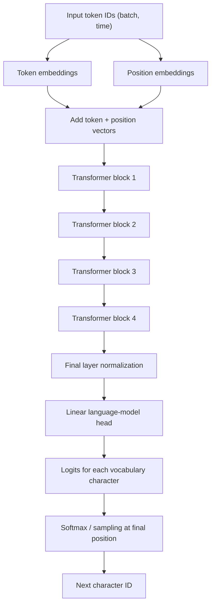
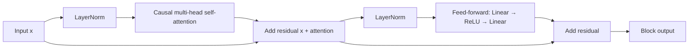

# Build a Tiny Language Model from Scratch

> A hands-on, character-level Transformer in PyTorch. Follow the path from raw
> text to next-character predictions, attention, training, and generated text.

This project is intentionally small enough to read in one sitting. It is an
educational decoder-only Transformer trained on the Tiny Shakespeare text. It
does not download pretrained weights: the model learns its parameters from the
training data in this project.

> **Scope:** "from scratch" here means building the language-model pipeline and
> Transformer components yourself with PyTorch tensor operations and layers. It
> does not mean implementing tensor math or automatic differentiation from
> scratch. This is a learning project, not a general-purpose or production LLM.

## What you will learn

- How characters become integer token IDs and back again.
- How to create shifted input/target examples for next-token prediction.
- How embeddings represent tokens and their positions.
- How causal self-attention lets a character use only its past context.
- How Transformer blocks, cross-entropy, and AdamW fit into training.
- How to sample new text and save/load model weights.

## At a glance

| Component | Current setting |
| --- | ---: |
| Data | Tiny Shakespeare (`input.txt`) |
| Tokenization | One character per token |
| Train / validation split | 90% / 10%, in file order |
| Context length (`block_size`) | 256 characters |
| Batch size | 32 sequences |
| Embedding width | 192 |
| Attention heads | 4 (48 dimensions per head) |
| Transformer blocks | 4 |
| Training iterations | 5,000 |
| Evaluation | Every 500 iterations, 20 batches per split |
| Dropout | 0.2 |
| Learning rate | 0.001 |
| Device preference | CUDA, then Apple MPS, then CPU |
| Generation length | 500 characters |

These are the values currently set near the top of [`bigram.py`](./bigram.py).
They are starting points, not universal recommendations. The run time varies by
hardware and device backend.

## How the pieces fit together

### End-to-end workflow

```mermaid
flowchart LR
    A["Tiny Shakespeare text"] --> B["Character vocabulary"]
    B --> C["Encode characters as IDs"]
    C --> D["90% train / 10% validation"]
    D --> E["Sample batches of sequences"]
    E --> F["Transformer predicts next character"]
    F --> G["Cross-entropy loss"]
    G --> H["AdamW updates weights"]
    H --> I{"More iterations?"}
    I -- Yes --> E
    I -- No --> J["Save model.pth"]
    J --> K["Load weights (later run)"]
    K --> L["Sample characters autoregressively"]
    L --> M["Decode IDs as text"]
```



### One training example

The target sequence is the input shifted one character to the right. Every
position asks the model to predict the next character:

```text
text:    T  o  b  e  ,  o  r
input:   T  o  b  e  ,  o
target:  o  b  e  ,  o  r
```

With `block_size = 256`, each sampled input has up to 256 characters, and the
target at each position is the following character. A batch contains 32 such
input/target pairs. Examples are sampled at random from the training portion of
the encoded text.

### Transformer architecture



Each Transformer block contains two residual sublayers:



### What causal attention means

At sequence position *t*, the model may use positions `0` through *t* but must
not see future characters. The lower-triangular mask in `Head` fills future
attention scores with negative infinity; softmax then assigns those positions
zero weight.

For queries `Q`, keys `K`, and values `V`, a head computes scaled attention:

```text
Attention(Q, K, V) = softmax((Q Kᵀ / √d_h) + causal_mask) V
```

The four heads run in parallel, each with a 48-dimensional key/query/value
space. Their outputs are concatenated and projected back to the 192-dimensional
embedding width. The mask is registered as a model buffer, so it moves with the
model to CUDA, Apple MPS, or CPU.

**Implementation detail:** in the current `Head.forward`, the scale is
`C**-0.5`, where `C` is the input embedding width (192). The standard
per-head scale in the formula above uses `d_h` (48). If you change the code to
use `head_size**-0.5`, retrain the checkpoint so its weights are learned with
that scaling.

## Run it

### 1. Get the code and dependencies

Python 3.12 is selected in `.python-version`. The project uses `uv` and declares
PyTorch in `pyproject.toml`.

```bash
uv sync
```

Alternatively, activate the existing virtual environment and use its Python:

```bash
source .venv/bin/activate
```

### 2. Get the training text

The script expects `input.txt` in the project root:

```bash
curl -L \
  https://raw.githubusercontent.com/karpathy/char-rnn/master/data/tinyshakespeare/input.txt \
  -o input.txt
```

### 3. Train and save the model

In `bigram.py`, set:

```python
train_model = True
```

Then run:

```bash
uv run python bigram.py
```

The script prints training and validation losses during training, saves the
model's state dictionary to `model.pth`, and generates a 500-character sample.
The checkpoint contains model weights, not the optimizer state or training
history.

### 4. Generate again without training

Once `model.pth` exists, change the flag to:

```python
train_model = False
```

Run the same command again. The script constructs the same model, loads its
weights, and goes directly to generation.

The architecture, context length, vocabulary, and character-to-ID mapping must
match the checkpoint. In practice, keep the same model settings and the same
`input.txt` when reloading. If no compatible checkpoint exists, set
`train_model = True` to create one.

## From text to generated text

1. **Build the vocabulary.** The script sorts the unique characters in the text
   and creates `stoi` (character to integer) and `itos` (integer to character)
   maps. This is character tokenization: punctuation, spaces, and line breaks
   are all tokens too.
2. **Encode and split.** The complete text becomes a one-dimensional `LongTensor`.
   The first 90% is training data; the last 10% is validation data.
3. **Make batches.** `get_batch` picks random starting offsets and creates
   overlapping windows. Each target window is the corresponding input shifted
   by one character.
4. **Embed.** The token embedding gives each character a learned vector. A
   learned position embedding is added so the model can distinguish where a
   character appears in the context.
5. **Attend causally.** Each attention head scores how much each allowed earlier
   position matters. The causal mask prevents looking ahead.
6. **Process and predict.** Attention and feed-forward sublayers are repeated
   through four blocks. A final linear layer produces one score (a logit) for
   every character in the vocabulary at every input position.
7. **Measure error.** Cross-entropy compares those logits with the shifted
   target IDs. Lower loss means the correct next character tends to receive a
   higher predicted probability; it does not by itself guarantee coherent text.
8. **Learn.** `loss.backward()` computes gradients, and AdamW updates model
   parameters. This repeats for 5,000 iterations.
9. **Evaluate.** Every 500 iterations, the script estimates average loss from
   20 random batches of both training and validation data. Evaluation runs
   without gradients and switches dropout off.
10. **Generate.** Starting from a one-token context, the model gets logits for
    the final position, applies softmax, samples one character with
    `torch.multinomial`, appends it, and repeats. It uses only the last
    `block_size` characters as context.
11. **Decode.** `itos` turns the generated IDs back into readable characters.

## Understanding the main settings

- **`block_size`**: maximum context visible to the model. Self-attention work and
  memory grow substantially as this increases (attention scores scale
  quadratically with context length).
- **`batch_size`**: sequences processed in one optimizer step. Larger batches
  use more memory and can make each step slower, but estimate gradients from
  more examples at once.
- **`n_embd`**: width of token and position vectors; larger widths increase
  model capacity and computation.
- **`n_head`**: number of parallel attention heads. It should divide
  `n_embd`; here `192 / 4 = 48` dimensions per head.
- **`n_layer`**: number of Transformer blocks stacked sequentially.
- **`max_iters`**: number of optimizer updates, not the number of generated
  characters.
- **`eval_iters` / `eval_interval`**: validation/training loss sampling amount
  and frequency. More frequent or longer evaluations add run time.
- **`learning_rate`**: size of AdamW's parameter updates. Too high can make
  training unstable; too low can learn slowly.
- **`dropout`**: regularization applied in attention and feed-forward paths
  during training. It is disabled during evaluation and generation.
- **`max_new_tokens`**: number of characters to generate after the initial
  context. Generation is sequential, so increasing it adds time but does not
  retrain or improve the learned model.
- **`device`**: chooses CUDA when available, otherwise Apple MPS when available,
  otherwise CPU.

## Where to look in the code

| Code | Responsibility |
| --- | --- |
| Hyperparameters and device choice | Values at the top of [`bigram.py`](./bigram.py) |
| `encode`, `decode` | Character/integer conversion |
| `get_batch` | Random input and shifted-target windows |
| `estimate_loss` | Train/validation loss estimates |
| `Head` | Scaled causal self-attention |
| `MultiHeadAttention` | Parallel heads and output projection |
| `FeedFoward` | Position-wise nonlinear transformation |
| `Block` | Attention, feed-forward, normalization, residuals |
| `BigramLanguageModel` | Embeddings, blocks, logits, and generation |
| `train_model` branch | Train/save or load checkpoint |

The class name `BigramLanguageModel` is retained from the tutorial-style
starting point; the current implementation includes context, attention, and
multiple Transformer blocks rather than only a bigram lookup table.

## Limitations and next experiments

- This model learns only from one small text corpus and predicts characters, not
  words or subword tokens.
- It has no large-scale pretraining, instruction tuning, retrieval, or safety
  layer. Its output can be repetitive, nonsensical, or biased by the data.
- The validation split is the final 10% of the text, not a separate source.
- Generation samples from a probability distribution with
  `torch.multinomial`; the output can vary when the random state differs.
- The checkpoint is tied to the model dimensions and vocabulary used to create
  it. Changing those requires training a new checkpoint.

Good controlled experiments include changing one of `block_size`, `n_embd`,
`n_head`, `n_layer`, or `learning_rate` at a time, then comparing validation
loss and generated samples. Keep `max_iters` fixed when comparing model
settings.

## Project files

```text
.
├── bigram.py       # model, training/evaluation loop, checkpointing, generation
├── input.txt       # download separately; ignored by Git
├── model.pth       # created by training; ignored by Git
├── pyproject.toml  # Python project metadata and dependency
├── uv.lock         # locked dependency versions
└── src/            # package scaffold
```

## Acknowledgments

The training text is Tiny Shakespeare, distributed in Andrej Karpathy's
[`char-rnn` repository](https://github.com/karpathy/char-rnn). This project is
an educational implementation inspired by the character-level language-model
lessons in [Neural Networks: Zero to Hero](https://karpathy.ai/zero-to-hero.html).